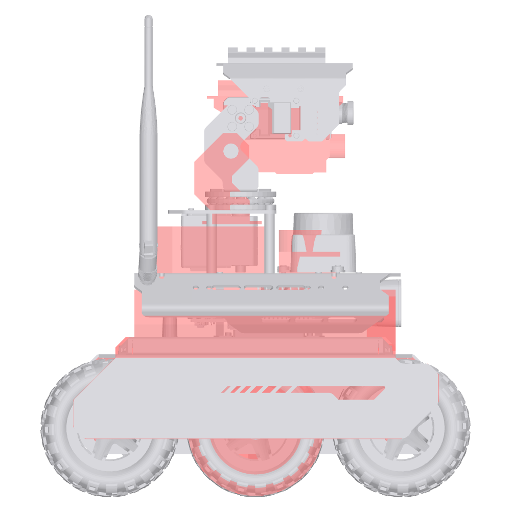

# Robot model versus Waveshare's CAD

The Webots robot model (`ugv_webots/protos/UgvRover.proto`) takes its kinematics from the
upstream URDF (`ugv_description/urdf/bases/ugv_rover.xacro`) and, since the high detail
model, its visuals from Waveshare's STEP model of the **UGV Rover PT Jetson Orin ROS2 Kit**
(see [SIMULATOR.md, Robot model](SIMULATOR.md#robot-model)). This page records where the
two disagree, how it was measured, and what was changed.

**What changed:** the lidar, OAK and pan-tilt frames of `ugv_rover` now follow the CAD
(table below). Masses, inertias, joint axes, wheel frames and the other robots
(`rasp_rover`, `ugv_beast`) are unchanged. `export UGV_KIT=upstream` (or the xacro argument
`kit:=upstream`) restores Waveshare's original values (byte for byte the same URDF as
before).

## How it was measured

* The STEP was tessellated with OpenCascade (`build_rover_meshes.py`) and put in
  `base_link`: the CAD frame has x pointing backwards and y to the right, so
  `base_link = Rz(180 deg) * CAD / 1000`. Its origin is the top face of the chassis between
  the wheel axles, which is also the URDF `base_link` origin (wheel centres agree to 0.1 mm,
  see below).
* Every URDF mesh (`ugv_description/meshes`) was placed at its link pose with joints at
  zero and fitted to the CAD part it represents with ICP (6000 points on the URDF mesh,
  200000 on the CAD, 90 % inliers). The fitted translation is the offset of that link, the
  residual (RMS distance after the fit) shows the URDF mesh really is that CAD part.
* Joint axes were read from the CAD directly: the servo horns (`金属舵盘`) give the pan
  and tilt axes, the LD19 dome gives the lidar rotation axis.
* The 2D drawing from the same Waveshare page (`docs/reference/ugv_rover_pt_jetson_orin_2d_drawing.pdf`)
  agrees with the STEP: length 252.4 mm, width 230.42 mm, height to the camera rail
  264.13 mm, to the antenna tips 283.09 mm (CAD: 252.4, 230.4, 264.1, 283.1).

## Measured before the change (base_link frame, millimetres)

| Frame or part | URDF | CAD | CAD minus URDF | URDF mesh fit residual |
|---|---|---|---|---|
| Driven wheel centres (4) | x ±85.50, y ±87.25, z -41.21 | x ±85.5, y ±87.3, z -41.2 | below 0.1 | wheel radius 40.0 (URDF) vs 40.6 (CAD tyre) |
| Middle wheel centres (2) | not modelled | x 0, y ±88.3, z -41.2 | | |
| Chassis (`base_link` mesh, lower part) | | | below 0.2 in x and y | median 1.6 (simplified mesh) |
| Deck top (top of the URDF base mesh) | z 40.0 | z 49.6 | **+9.6** | |
| `base_lidar_link` (LD19 axis and base) | (31.7, -1.0, 40.0) | (39.8, 0.1, 50.0) | **(+8.1, +1.1, +10.0)** | 0.5 |
| `oak_base` (OAK-D Lite body) | (65.3, 0, 22.0) | (68.4, 0, 32.1) | **(+3.1, 0, +10.1)** | 0.9 |
| Pan axis (`pt_base_link_to_pt_link1`) | x -14.4, y 0 | x -8.7, y 0 | **+5.7 in x** | |
| `pt_base_link` (mount on the deck) | z 40.0 | z 49.6 | +9.6 | 4.6 (different standoffs) |
| `pt_link1` (pan bracket) | origin (-14.4, 0, 78.3) | | **(+5.6, 0, +19.1)** | 0.4 |
| Tilt axis (`pt_link1_to_pt_link2`) | x -14.4, z 121.3 | x -8.7, z 140.6 | **(+5.7, +19.3) in x, z** | |
| `pt_link2` (camera head) | | | (+4.8, -0.9, +18.9) | 3.1 |
| `pt_camera_link` (camera board) | (34.0, 0, 120.7) | | (+5.8, -0.5, +19.4) | 1.7 |

Wheel separation, wheel radius and the base of the robot agree. Everything mounted on the
upper deck sits 10 mm lower in the URDF than on this kit, and the pan-tilt head 19 mm lower
and 6 mm further back. The URDF meshes match the CAD parts almost exactly once shifted
(0.4 to 0.9 mm for the lidar, the OAK and the pan bracket), so the URDF describes the same
parts mounted differently: most likely the Raspberry Pi build of the rover, which has no
Jetson under the deck (lower standoffs) and shorter pan-tilt standoffs (`M3*35` in this kit).

## Changes to the URDF

`ugv_description/urdf/bases/ugv_rover.xacro` gets an argument `kit` (default from the
environment variable `UGV_KIT`, else `jetson_orin`); `ugv_description/urdf/sensors/pt.xacro` gets two optional macro parameters
(`pt_base_link_joint_pose_x`, `pan_joint_pose_z`) whose defaults are the old values, so the
other robots that include it are unchanged.

| Joint | Before (`kit:=upstream`) | After (`kit:=jetson_orin`) | Evidence |
|---|---|---|---|
| `base_lidar_link_joint` | xyz (0.03170, -0.00102, 0.04) | xyz (0.0398, 0.0001, 0.0500) | LD19 rotation axis and base in the CAD |
| `oak_base_joint` | xyz (0.06531, 0, 0.021953) | xyz (0.0684, 0, 0.0321) | URDF OAK mesh fitted to the CAD OAK-D Lite (0.9 mm) |
| `pt_base_link_joint` | xyz (-0.02571, 0, 0.04) | xyz (-0.02001, 0, 0.0496) | pan servo horn axis, deck top in the CAD |
| `pt_base_link_to_pt_link1` | xyz (0.0113, 0, 0.0383) | xyz (0.0113, 0, 0.0478) | pan bracket fitted to the CAD (0.4 mm) |

Unchanged and confirmed: `pt_link1_to_pt_link2` (tilt axis 0.2 mm from the CAD horn after
the change), `pt_camera_link_joint` (camera board fit 0.5 mm), all wheel joints, all
inertials. After the change the URDF meshes sit on the CAD parts within 1 mm (lidar 0.9,
OAK 0.1, pan bracket 0.1, head 0.9, camera 0.6 mm); only `pt_base_link` stays 4 mm off,
because its URDF mesh is a shorter pan-tilt base than the kit's.

Effects:

* **Real robot.** `ugv_bringup` builds TF from the same xacro, so on the robot the lidar,
  OAK and pan-tilt camera frames move by these amounts too (they were wrong by up to 2 cm).
  A robot with the lower deck (Waveshare's Raspberry Pi build, if that is what the old
  values describe) should set `export UGV_KIT=upstream` next to `UGV_MODEL`.
* **Simulation.** The sensors move with their frames: the lidar scan plane is 10 mm higher,
  the cameras 10 and 19 mm higher. Driving is unchanged (`motion_check`: 1.000 m forward,
  360.3 / 359.7 degrees odometry / truth for a full turn, as before). The combined body's
  centre of mass moves by 0.6 mm.
* **High detail visuals.** `GROUP_SHIFT` in `build_rover_meshes.py` is zero now: the CAD
  parts sit where the CAD puts them and joints turn about the axes you see.
* **Low detail visuals.** The URDF base mesh still has the lower deck, so in `detail:=low`
  the lidar, OAK and pan-tilt meshes float about 10 mm above it.

## Drivetrain: six wheels, four joints

The kit has six wheels. The CAD shows four `JGB37-520` gear motors (front and rear wheels,
shaft couplers `COUPLING 6mm`) and two **unpowered** middle wheels on `F624ZZ` flanged
bearings in `BEAR-HOLDER` brackets, with nylon spacers. The URDF models only the four
driven wheels as joints (`left_up`, `left_down`, `right_up`, `right_down`); its chassis
mesh `ugv_rover_base.stl` already draws all six wheels as part of the static body.

The high detail model keeps that split: the middle wheels are visual only, fixed to the
chassis (same wheel mesh, at the CAD centres). They were not made passive wheels with
contacts because the drive was tuned with four contacts (asymmetric friction plus
`wheel_separation_multiplier`, see [SIMULATOR.md](SIMULATOR.md#drive-and-contact-tuning)),
and that tuning already stands in for the scrub of the middle wheels; two more contacts
would change turning, odometry checks and the mass, which this change must not touch. The
cost is that the middle wheels do not spin in the simulation.
